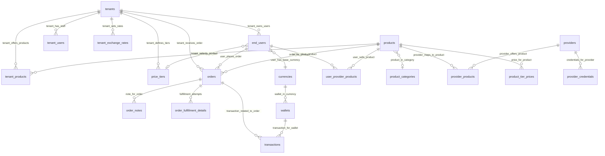

# Ahla Database - Enhanced ER Diagram with Relationships

```
┌─────────────────────────────────────────────────────────────────────────────────┐
│                         MULTI-TENANCY & USER MANAGEMENT                          │
└─────────────────────────────────────────────────────────────────────────────────┘

                              ┌──────────────┐
                              │ super_admins │
                              │──────────────│
                              │ id (PK)      │
                              │ email        │
                              │ username     │
                              └──────┬───────┘
                                     │
                        announcement_created_by_admin
                                     │
                                     ▼
                              ┌──────────────┐
                      ┌───────│   tenants    │
                      │       │──────────────│
                      │       │ id (PK)      │
                      │       │ subdomain    │
                      │       │ wallet_bal   │
                      │       └──────┬───────┘
                      │              │
                      │              │ tenant_owns_users
                      │              │ tenant_has_staff
                      │              │ tenant_offers_products
                      │              │ tenant_sets_rates
                      │              │ tenant_defines_tiers
                      │              │
        ┌─────────────┼──────────────┼────────────────┬──────────────┐
        │             │              │                │              │
        │ tenant_     │ tenant_      │ tenant_        │ tenant_      │ announcement_
        │ receives_   │ has_staff    │ offers_        │ defines_     │ targets_tenant
        │ order       │              │ products       │ tiers        │
        ▼             ▼              ▼                ▼              ▼
  ┌──────────┐  ┌──────────┐  ┌──────────┐    ┌──────────┐  ┌──────────────┐
  │ orders   │  │tenant_   │  │tenant_   │    │price_    │  │announcements │
  └──────────┘  │users     │  │products  │    │tiers     │  └──────────────┘
                └────┬─────┘  └──────────┘    └────┬─────┘
                     │                              │
            rate_set_by_staff           user_belongs_to_tier
                     │                              │
                     ▼                              ▼
            ┌──────────────┐              ┌─────────────────┐
            │tenant_       │              │   end_users     │
            │exchange_     │              │─────────────────│
            │rates         │              │ id (PK)         │
            └──────────────┘              │ tenant_id (FK)  │◄─┐
                                          │ email           │  │
                                          │ username        │  │ tenant_owns_users
                                          │ can_sell_to_    │  │
                                          │ others (bool)   │  │
                                          └────┬─────┬──────┘  │
                                               │     │         │
                              user_places_     │     │ seller_offers_
                              order            │     │ product
                                               │     │
                                               ▼     ▼
                                          ┌──────────────────┐
                                          │user_provider_    │
                                          │products          │
                                          │──────────────────│
                                          │ P2P Marketplace  │
                                          └──────────────────┘


┌─────────────────────────────────────────────────────────────────────────────────┐
│                         PRODUCTS & CATALOG RELATIONSHIPS                         │
└─────────────────────────────────────────────────────────────────────────────────┘

                    ┌──────────────────────┐
                    │ product_categories   │
                    │──────────────────────│
                    │ id (PK)              │
                    │ name                 │
                    └──────────┬───────────┘
                               │
                               │ product_in_category
                               │
                               ▼
                    ┌──────────────────────┐
                    │     products         │
                    │──────────────────────│
                    │ id (PK)              │
                    │ category_id (FK) ────┘
                    │ code (UNIQUE)        │
                    │ name                 │
                    │ base_cost_usd        │
                    │ customizable (bool)  │
                    └──────────┬───────────┘
                               │
                ┌──────────────┼──────────────┬────────────────┐
                │              │              │                │
    tenant_     │  provider_   │  user_sells_ │  code_for_     │  price_for_
    selects_    │  maps_to_    │  product     │  product       │  product
    product     │  product     │              │                │
                │              │              │                │
                ▼              ▼              ▼                ▼
    ┌────────────────┐ ┌──────────────────┐ ┌──────────────┐ ┌──────────────┐
    │tenant_products │ │provider_products │ │user_provider │ │product_tier_ │
    │────────────────│ │──────────────────│ │_products     │ │prices        │
    │ tenant_id (FK) │ │ provider_id (FK) │ │──────────────│ │──────────────│
    │ product_id(FK) │ │ product_id (FK)  │ │ seller_id    │ │ product_id   │
    │ enabled        │ │ external_id      │ │ product_id   │ │ tier_id      │
    │ custom_cost    │ │ cost_usd         │ │ cost_usd     │ │ price_usd    │
    └────────────────┘ │ priority         │ │ stock_qty    │ └──────────────┘
                       │                  │ │ available    │
                       │ ZNet fields:     │ └──────────────┘
                       │ • znet_adi_name  │
                       │ • znet_fiyat_    │
                       │   price          │
                       │ • znet_oyun      │
                       │ • znet_kupur     │
                       │ • znet_bilgi_id  │
                       │                  │
                       │ ZDK fields:      │
                       │ • zdk_id         │
                       │                  │
                       │ Cross-system:    │
                       │ • AHLA_id       │
                       │ • external_name  │
                       └──────────────────┘
                               ▲
                               │
                  provider_offers_product
                               │
                    ┌──────────┴───────────┐
                    │     providers        │
                    │──────────────────────│
                    │ id (PK)              │
                    │ type (znet/zdk/etc)  │
                    │ base_url             │
                    │ wallet_balance       │
                    └──────────────────────┘


┌─────────────────────────────────────────────────────────────────────────────────┐
│                         ORDER FLOW & FULFILLMENT                                 │
└─────────────────────────────────────────────────────────────────────────────────┘

    ┌──────────────┐
    │  end_users   │
    └──────┬───────┘
           │
           │ user_places_order
           │
           ▼
    ┌──────────────────────────────────────────────────────────────┐
    │                         orders                               │
    │──────────────────────────────────────────────────────────────│
    │ id (PK)                                                      │
    │ tenant_id (FK) ──────────► tenant_receives_order            │
    │ end_user_id (FK) ────────► user_places_order                │
    │ product_id (FK) ─────────► order_for_product                │
    │                                                              │
    │ user_entered_cost      (never changes)                      │
    │ user_payment_amount    (in user's currency)                 │
    │ actual_cost_usd        (real provider cost)                 │
    │                                                              │
    │ fulfillment_type       (manual/auto)                        │
    │ fulfilled_by_type      (provider/end_user/tenant_user)      │
    │ status                 (pending/completed/rejected)         │
    │                                                              │
    │ result_codes[]         (PIN/Serial)                         │
    │ provider_response      (raw JSON)                           │
    └──────┬───────────────────────────────────────────────────────┘
           │
           │ note_for_order
           │ fulfillment_attempts_for_order
           │ transaction_related_to_order
           │
       ┌───┴───────┬──────────────┬──────────────┐
       │           │              │              │
       ▼           ▼              ▼              ▼
┌────────────┐ ┌────────────┐ ┌────────────┐ ┌────────────┐
│order_notes │ │order_      │ │transactions│ │audit_logs  │
│────────────│ │fulfillment_│ │────────────│ │────────────│
│ order_id   │ │details     │ │ order_id   │ │ entity_id  │
│ note       │ │────────────│ │ type       │ │ changes    │
│ created_by │ │ order_id   │ │ amount     │ └────────────┘
└────────────┘ │ attempt_#  │ └────────────┘
               │ source_type│
               │ source_id  │
               │ success    │
               └────────────┘


┌─────────────────────────────────────────────────────────────────────────────────┐
│                    FULFILLMENT SOURCES (Who Fulfills Orders?)                    │
└─────────────────────────────────────────────────────────────────────────────────┘

    Order fulfillment_by_type can be:

    ┌──────────────┐      ┌──────────────┐      ┌──────────────┐
    │  providers   │      │  end_users   │      │code_inventory│
    │──────────────│      │──────────────│      │──────────────│
    │ type: znet   │  OR  │ can_sell:    │  OR  │ pre-bought   │
    │ type: zdk    │      │ true         │      │ codes ready  │
    │ API auto     │      │ P2P sell     │      │ manual use   │
    └──────┬───────┘      └──────┬───────┘      └──────┬───────┘
           │                     │                     │
           │ provider_offers_    │ seller_offers_      │ code_for_
           │ product             │ product             │ product
           │                     │                     │
           └─────────────────────┼─────────────────────┘
                                 │
                    fulfillment_attempts_for_order
                                 │
                                 ▼
                    ┌──────────────────────────┐
                    │ order_fulfillment_       │
                    │ details                  │
                    │──────────────────────────│
                    │ Records each attempt     │
                    │ Tracks success/failure   │
                    │ Supports retries         │
                    │ Logs provider responses  │
                    └──────────────────────────┘


┌─────────────────────────────────────────────────────────────────────────────────┐
│                    PRICING & CURRENCY RELATIONSHIPS                              │
└─────────────────────────────────────────────────────────────────────────────────┘

                    ┌──────────────────────┐
                    │    currencies        │
                    │──────────────────────│
                    │ id (PK)              │
                    │ code (USD/TRY/SYP)   │
                    │ symbol               │
                    └──────────┬───────────┘
                               │
                               │ user_has_base_currency
                               │ rate_for_currency
                               │ wallet_in_currency
                               │ order_paid_in_currency
                               │
                ┌──────────────┼──────────────┬────────────────┐
                │              │              │                │
                ▼              ▼              ▼                ▼
    ┌────────────────────┐ ┌──────────┐ ┌──────────┐ ┌──────────┐
    │tenant_exchange_    │ │end_users │ │orders    │ │wallets   │
    │rates               │ │──────────│ │──────────│ │──────────│
    │────────────────────│ │ base_cur │ │ payment_ │ │ currency │
    │ tenant_id (FK) ────┼─┤ (FK)     │ │ cur(FK)  │ │ (FK)     │
    │ currency_id (FK) ──┘ └──────────┘ └──────────┘ └──────────┘
    │ rate_to_usd        │
    │ effective_from     │
    └────────┬───────────┘
             │
             │ (logged via)
             │
             ▼
    ┌──────────────────────┐
    │exchange_rate_change_ │
    │log                   │
    │──────────────────────│
    │ tenant_id (FK) ───────► rate_change_for_tenant
    │ currency_id (FK) ─────► rate_change_currency
    │ changed_by_user ──────► rate_changed_by_staff
    │ old_rate             │
    │ new_rate             │
    │ changed_at           │
    │ change_reason        │
    └──────────────────────┘


┌─────────────────────────────────────────────────────────────────────────────────┐
│                    WALLET SYSTEM & CREDIT LINE                                   │
└─────────────────────────────────────────────────────────────────────────────────┘

    ┌─────────────────────────────────────────────────────────────┐
    │                       end_users                             │
    │─────────────────────────────────────────────────────────────│
    │ wallet_balance        500.00  (current)                     │
    │ credit_line          1000.00  (overdraft limit)             │
    │                                                              │
    │ Available = wallet_balance + credit_line = 1500.00          │
    └─────────────────────┬───────────────────────────────────────┘
                          │
                          │ (tracked via)
                          │
                          ▼
    ┌─────────────────────────────────────────────────────────────┐
    │                    wallets                                  │
    │─────────────────────────────────────────────────────────────│
    │ owner_type (end_user/tenant/provider)                       │
    │ owner_id (FK)                                               │
    │ currency_id (FK) ──────► wallet_in_currency                │
    │ balance                                                      │
    └────────────────┬────────────────────────────────────────────┘
                     │
                     │ transaction_for_wallet
                     │
                     ▼
    ┌─────────────────────────────────────────────────────────────┐
    │                    transactions                             │
    │─────────────────────────────────────────────────────────────│
    │ wallet_id (FK) ──────────► transaction_for_wallet           │
    │ currency_id (FK) ────────► transaction_in_currency          │
    │ related_order_id (FK) ───► transaction_related_to_order     │
    │                                                              │
    │ type: deposit        (+)  Add money                         │
    │ type: order_payment  (-)  Deduct for order                  │
    │ type: settlement     (+)  Repay credit line                 │
    │ type: order_refund   (+)  Return money                      │
    │                                                              │
    │ balance_before                                               │
    │ balance_after       ← Can go NEGATIVE (using credit)        │
    │                                                              │
    │ payment_rail_type (trust_fund/bank/cash/binance/hawala)    │
    │ payment_rail_details (JSON with account info)              │
    └─────────────────────────────────────────────────────────────┘

    Example Credit Usage:
    ┌────────────────────────────────────────────────────┐
    │ 1. User: balance=500, credit_line=1000             │
    │ 2. Order for 700 created                           │
    │ 3. After: balance=-200 (using 200 of credit)       │
    │ 4. Available credit remaining: 800                 │
    │ 5. User deposits 500 (settlement transaction)      │
    │ 6. After: balance=300 (back to positive)           │
    └────────────────────────────────────────────────────┘


┌─────────────────────────────────────────────────────────────────────────────────┐
│                    COMPLETE RELATIONSHIP INDEX                                   │
└─────────────────────────────────────────────────────────────────────────────────┘

**User Management:**
├─ tenant_owns_users ..................... tenants → end_users
├─ tenant_has_staff ..................... tenants → tenant_users
├─ user_has_base_currency ............... end_users → currencies
├─ user_belongs_to_tier ................. end_users → price_tiers
└─ user_places_order .................... end_users → orders

**Product Management:**
├─ product_in_category .................. products → product_categories
├─ tenant_offers_products ............... tenants → tenant_products
├─ tenant_selects_product ............... tenant_products → products
├─ price_for_product .................... product_tier_prices → products
└─ price_for_tier ....................... product_tier_prices → price_tiers

**Pricing & Rates:**
├─ tenant_sets_rates .................... tenants → tenant_exchange_rates
├─ rate_for_currency .................... tenant_exchange_rates → currencies
├─ rate_set_by_staff .................... tenant_exchange_rates → tenant_users
├─ rate_change_for_tenant ............... exchange_rate_change_log → tenants
├─ rate_change_currency ................. exchange_rate_change_log → currencies
├─ rate_changed_by_staff ................ exchange_rate_change_log → tenant_users
└─ tenant_defines_tiers ................. tenants → price_tiers

**Provider Management:**
├─ provider_uses_currency ............... providers → currencies
├─ credentials_for_provider ............. provider_credentials → providers
├─ tenant_has_provider_creds ............ provider_credentials → tenants
├─ provider_offers_product .............. provider_products → providers
└─ provider_maps_to_product ............. provider_products → products

**P2P Marketplace:**
├─ seller_offers_product ................ user_provider_products → end_users
└─ user_sells_product ................... user_provider_products → products

**Order Processing:**
├─ tenant_receives_order ................ orders → tenants
├─ user_places_order .................... orders → end_users
├─ order_for_product .................... orders → products
├─ order_cost_in_currency ............... orders → currencies (cost)
├─ order_paid_in_currency ............... orders → currencies (payment)
├─ note_for_order ....................... order_notes → orders
└─ fulfillment_attempts_for_order ....... order_fulfillment_details → orders

**Inventory:**
├─ code_from_provider ................... code_inventory → providers
├─ code_for_product ..................... code_inventory → products
└─ code_used_in_order ................... code_inventory → orders

**Financial:**
├─ wallet_in_currency ................... wallets → currencies
├─ transaction_for_wallet ............... transactions → wallets
├─ transaction_in_currency .............. transactions → currencies
└─ transaction_related_to_order ......... transactions → orders

**Notifications & Content:**
├─ announcement_targets_tenant .......... announcements → tenants
├─ announcement_created_by_admin ........ announcements → super_admins
├─ instructions_for_tenant .............. instructions → tenants
├─ instructions_for_product ............. instructions → products
└─ page_belongs_to_tenant ............... static_pages → tenants

**Audit:**
└─ audit_for_tenant ..................... audit_logs → tenants


┌─────────────────────────────────────────────────────────────────────────────────┐
│                    KEY FEATURES SUMMARY                                          │
└─────────────────────────────────────────────────────────────────────────────────┘

✓ **Multi-Tenancy**:       Complete isolation via tenant_owns_users
✓ **P2P Marketplace**:     seller_offers_product enables user-to-user sales
✓ **Credit System**:       Overdraft support tracked via transactions
✓ **Immutable Currency**:  user_has_base_currency (set once, never changes)
✓ **Dynamic Pricing**:     tenant_defines_tiers + price_for_tier
✓ **Rate Management**:     tenant_sets_rates + complete change log
✓ **Flexible Fulfillment**: provider/end_user/code_inventory sources
✓ **Price Stability**:     user_entered_cost preserved regardless of actual_cost
✓ **Audit Trail**:         All relationships tracked in audit_logs

**Total Relationships: 50+ named foreign keys**
**All relationships are indexed for performance**
**Cascade deletes protect data integrity**
```

---

## Mermaid Diagram (Alternative - Copy to Mermaid Live Editor)



---

## To View:

**Option 1:** Read the enhanced text diagram above
**Option 2:** Copy the Mermaid code to https://mermaid.live/ 
**Option 3:** Use the original ER_DIAGRAM.md file

All relationships are clearly labeled! 🎉
